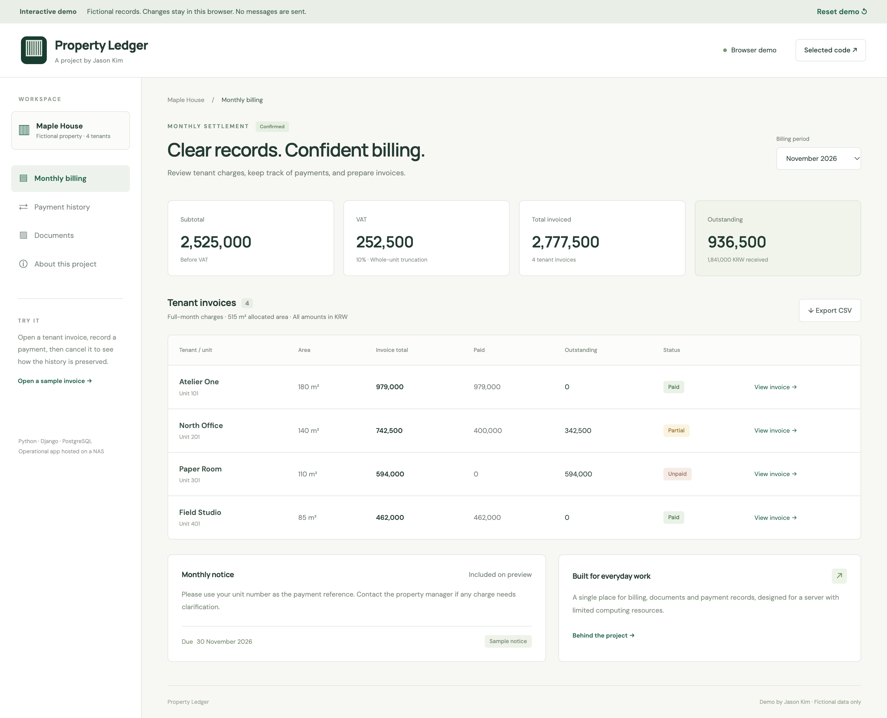

# Property Management Web App

Selected implementation examples from a web application developed by Jason Kim for Cheongmok, a property rental business.

## Why I built it

The client entered each tenant's charges in Excel, exported invoices as PDFs, emailed them, and manually saved spreadsheets, invoices and contract documents to Google Drive. Much of the work depended on access to a particular PC. The request was to bring these steps into a web application so authorized users could look up records and send invoices from different locations.

## What the application does

- Connects properties, units and leases with monthly billing.
- Generates PDF invoices and Excel reports and supports email delivery.
- Records partial payments and cancellations while retaining their history.
- Restricts access by user role and assigned property.
- Keeps supporting documents private and includes encrypted backup and restoration checks.
- Runs on a NAS, with attention to database queries, memory use and expensive concurrent tasks.

I handled the requirements, implementation, deployment and subsequent improvements. The application uses **Python, Django, PostgreSQL and Docker**. AI tools were part of my learning and development process; the examples below show concrete rules and tests rather than relying on generated output alone.

## Selected code

This is a curated companion to a private operational application, not a copy of its repository. The examples are small, dependency-free adaptations of implemented calculation, payment-summary and query-reuse patterns. They use synthetic data and are not a deployable financial system.

| Example | Question it addresses | Source |
| --- | --- | --- |
| Exact billing arithmetic | When should fractional charges be truncated? | [billing_math.py](examples/billing_math.py) |
| Payment history | How can a canceled payment remain visible without counting toward the balance? | [payment_history.py](examples/payment_history.py) |
| Query reuse | How can several balance fields reuse one database read? | [query_reuse.py](examples/query_reuse.py) |

Read the [implementation notes](docs/code-notes.md) for the relationship to the application and the details omitted from these examples.

## Run the examples

Python 3.9 or later; no third-party packages are required.

```sh
python3 -m unittest discover -s tests -v
python3 -m examples.demo
node --test tests/demo-model.test.cjs
```

The demo command runs a local command-line example against a temporary, in-memory SQLite database. It does not connect to the operational application or send email.

## Architecture

See [architecture and design choices](docs/architecture.md).

## Web demo and screenshots

A hosted demo link will be added when the new hosting location is ready.

The [browser demo source](demo/) illustrates monthly billing, payment recording and cancellation, PDF downloads, CSV export and simulated email. It uses fictional properties and records; it has no connection to the client system. Changes stay in your browser.

To run it locally:

```sh
python3 -m http.server 8765 --directory demo
```

Open `http://localhost:8765/`. Node.js is needed only for the optional model tests; the demo itself requires no build or installation.



See [both screenshots and capture notes](screenshots/README.md), including an invoice with a retained payment cancellation.
