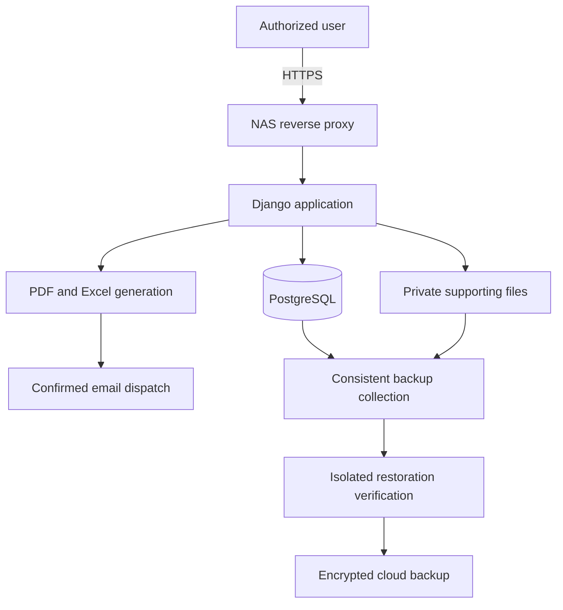

# Architecture and design choices

The operational application is a server-rendered Django service on a Synology NAS. This repository contains independently runnable extracts, not the deployment configuration.

## Financial accuracy

The Excel source could display a whole amount while retaining a fraction internally. The billing calculation therefore keeps exact intermediate amounts, sums them, and only then truncates the subtotal. VAT is truncated separately. Displayed line items include a reconciliation adjustment when their truncated values do not sum to the subtotal.

Issued historical invoices retain their original amounts. They are not silently recalculated using current leases or policies. Missing historical payment evidence is treated as unverified, rather than assumed unpaid.

## History and permissions

A payment cancellation keeps the original row and a reason. Post-confirmation invoice corrections preserve payment history and invoice identity. The application applies property and role checks on the server and uses transactions and locking for writes. The small public examples do not implement those authorization or write paths.

## Limited NAS resources

The application shares limited CPU and memory with other NAS services. The work includes removing duplicate payment queries, loading only needed output data, using protected thumbnails, and limiting concurrent expensive tasks. The public query example demonstrates bounded, request-local reuse rather than a persistent cache that could return an outdated balance.

## Backup and recovery

Backups include database records and the files they reference. Verification includes restoring into an isolated database and checking record fingerprints and file hashes. A successful upload alone is not treated as proof of recovery. Shortening the service-pause portion of backup must preserve the consistency of the captured data.

## Scope of the public examples

The examples use standard-library Python and in-memory SQLite to make the core ideas easy to run. The live application uses PostgreSQL and Django. These examples are not evidence of NAS capacity, a substitute for end-to-end testing, or a ready-to-deploy copy of the service.
